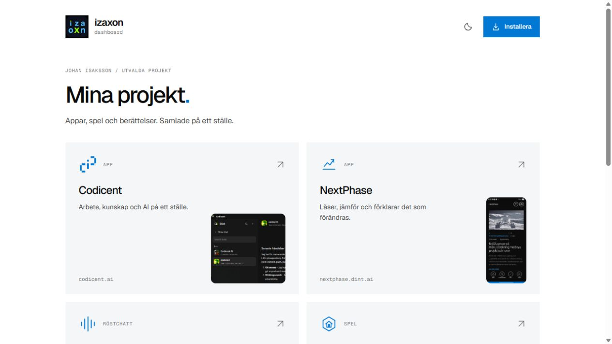

# izaxon

En minimal, installerbar dashboard för Johan Isakssons appar, spel och berättelser.

[Öppna dashboarden](https://app.izaxon.com/)



Vanlig HTML, CSS och JavaScript. Ingen backend, inga paketberoenden och inget byggsteg.

## Köra lokalt

Kör från repots rot:

```sh
python -m http.server 8080
```

Öppna sedan [http://localhost:8080](http://localhost:8080). Använd en webbserver i stället för att dubbelklicka på HTML-filen; service workers fungerar på `localhost` och på HTTPS.

## Publicera med GitHub Pages

1. Lägg koden på grenen `main` i `izaxon/izaxon-app`.
2. Öppna **Settings → Pages** i repot.
3. Välj **Deploy from a branch**, grenen **main** och mappen **/ (root)**.
4. Spara och invänta GitHubs publicering.

GitHub visar den publicerade adressen när publiceringen är klar. Appens relativa sökvägar, manifest och service worker fungerar både under `/izaxon-app/` och på en egen domäns rot.

Repot är konfigurerat att publicera `main` från rotmappen. `CNAME` anger den egna domänen, och ändringar på `main` publiceras automatiskt på **https://app.izaxon.com/**.

## Installera appen

- **Android:** öppna den publicerade sidan i Chrome. Använd appens installationsknapp när den erbjuds, eller webbläsarens meny för **Installera app** / **Lägg till på startskärmen**.
- **iPhone och iPad:** öppna sidan i Safari, välj **Dela → Lägg till på hemskärmen**.
- **Dator:** använd installationsknappen i en webbläsare som erbjuder installation.

Installationsmöjligheten beror på webbläsaren. Sidan fungerar även som en vanlig webbplats.

## Lägga till eller ändra projekt

Projektkorten finns direkt i `index.html`, så länkarna fungerar även utan JavaScript. Kopiera ett kort och ändra projektnamn, beskrivning, adress och ikon. Använd en riktig `https://`-länk.

Stilen finns i `styles.css`. Beteenden som installation och uppdatering finns i `app.js`.

Palmemordet-kortet har två separata länkar: rapporten är kortets primära mål och YouTube-länken ligger i kortets sidfot. Kort med flera mål använder `article` och klasserna `project-card-with-links`, `project-main-link` och `project-video-link`, så att länkarna förblir självständiga utan nästlade `a`-element.

## Design

Färger, typografi och geometri utgår från det uttryckliga blocket `@codicent-web-tokens` i [Codicents webbplats](https://github.com/izaxon/Codicent.ai/blob/main/index.html): Geist och Geist Mono, plana ytor, raka hörn, blå accent och systemets ljusa eller mörka läge. Den separata izaxon-ikonen används som appidentitet.

Typsnitten och ikonerna ligger lokalt i `assets/`.

Projektbilderna ligger lokalt i `assets/projects/`. Bildkort ger bilden en egen kolumn bredvid beskrivningen, medan projektnamnet använder hela kortbredden. Utsnitt, rundade hörn och ljusjustering styrs i `styles.css`; originalbilderna behålls. NextPhase visas i sin helhet, Codicent använder övre vänstra fjärdedelen och qrit samt Skreeky beskärs till själva ikonen respektive knappen.

Tidigare designförslag finns i `docs/design-previews/2026-11-08/`. De är historiska arbetsbilder, inte skärmbilder av den publicerade versionen; `havn-preview` är ett felbeskuret försök.

## Offline och uppdateringar

Efter ett lyckat första besök sparar `sw.js` själva dashboarden och dess lokala tillgångar. **De länkade projekten och Amazon kräver fortfarande internet.** Inga externa sidor eller API-anrop sparas i appens cache.

HTML, CSS, JavaScript och manifest hämtas från nätet när det går och använder det installerade appskalet som reserv. Projektbilder, ikoner och typsnitt hämtas från appens cache. En ny service worker väntar tills användaren väljer att uppdatera, eller tills alla öppna appfönster har stängts. Cachelagringen är avgränsad till appens eget scope och påverkar inte andra appar på samma domän.

**Ändra `VERSION` högst upp i `sw.js` vid varje ändring av en fil i `APP_SHELL`.** Publicera hela uppdateringen tillsammans. Om du lägger till eller tar bort en lokal tillgång, uppdatera även listan `APP_SHELL`. En misslyckad nedladdning av någon fil hindrar den nya versionen från att installeras; den tidigare service workern kan fortsätta användas.

## Filer

| Fil | Innehåll |
| --- | --- |
| `index.html` | Dashboard och projektlänkar |
| `styles.css` | Codicent-inspirerad responsiv design |
| `app.js` | Installations- och uppdateringsflöde |
| `manifest.webmanifest` | Appnamn, startadress och appikoner |
| `sw.js` | Begränsad offlinecache och versionshantering |
| `assets/` | Lokala ikoner och typsnitt |
